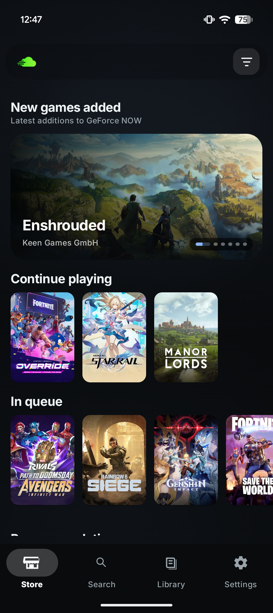
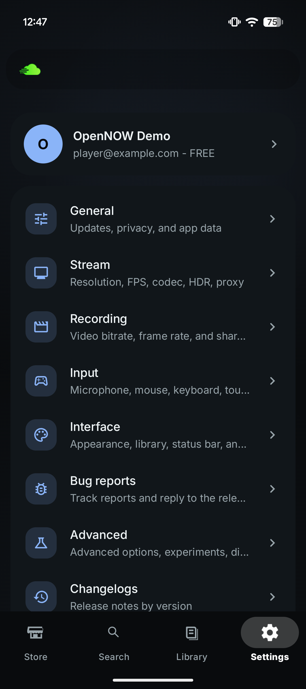
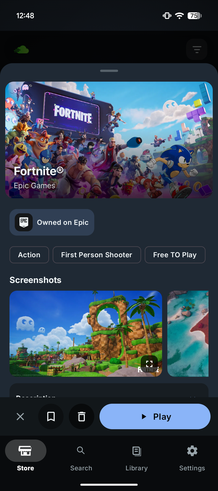
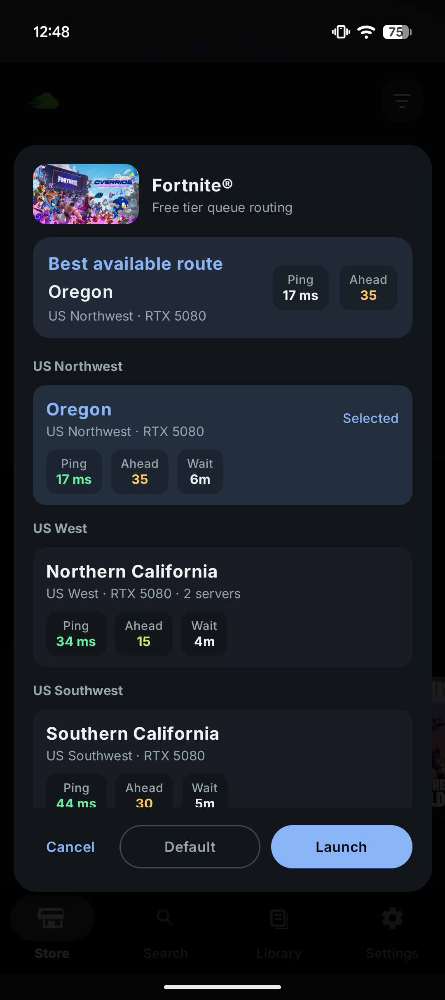
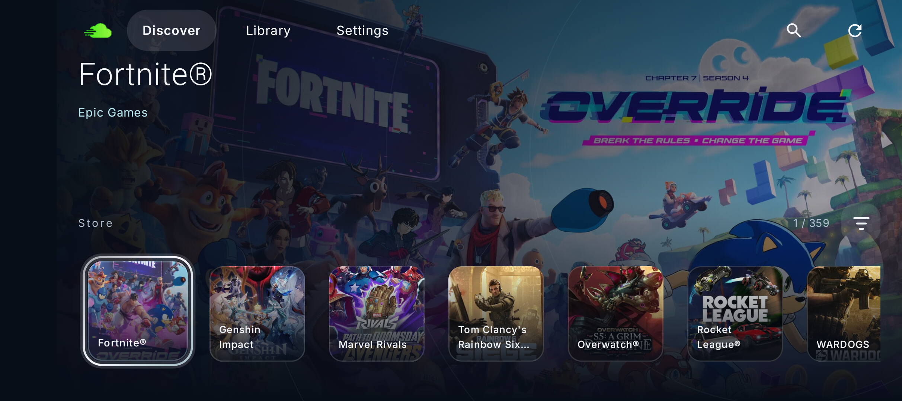
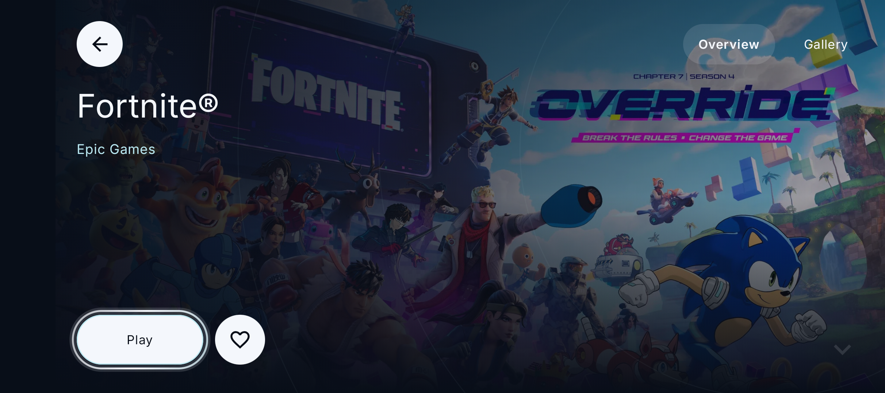

<h1 align="center">OpenNOW for Android</h1>

<p align="center">
  
</p>

<p align="center">
  <strong>An open-source GeForce NOW client for Android phones, tablets, handhelds, and TVs.</strong>
</p>

<p align="center">
  Browse your games, customize your stream, and play with touch, a controller, or a keyboard and mouse.
</p>

<p align="center">
  <a href="https://play.google.com/store/apps/details?id=com.opencloudgaming.opennow">
    
  </a>
  
  <a href="https://discord.gg/8EJYaJcNfD">
    
  </a>
  <a href="LICENSE">
    
  </a>
</p>

## Two ways to browse

Use the standard Android interface, or enable **Space UI** for a landscape, console-style experience with large artwork and game galleries. Animated focus outlines highlight game selection and primary actions when a controller is connected; settings use subtler feedback.

### Standard UI

Portrait captures from the Android phone interface.

<table>
  <tr>
    <th width="25%">Store</th>
    <th width="25%">Settings</th>
    <th width="25%">Game details</th>
    <th width="25%">Queue selector</th>
  </tr>
  <tr>
    <td><a href="android/docs/screenshots/standard-store.png"></a></td>
    <td><a href="android/docs/screenshots/standard-settings.png"></a></td>
    <td><a href="android/docs/screenshots/standard-game-details.png"></a></td>
    <td><a href="android/docs/screenshots/standard-queue-selector.png"></a></td>
  </tr>
</table>

### Space UI

**Discover**

<a href="android/docs/screenshots/space-ui-discover.png"></a>

**Game details**

<a href="android/docs/screenshots/space-ui-game-details.png"></a>

Enable Space UI in **Settings → Advanced → Experimental streaming → Space UI**, below L4S. It is optional, locks browsing to landscape, and works with touch or a controller. The standard interface remains the default. Screenshots show the installed Android app; Space UI is experimental and may change between builds. The profile shown in Settings is demo data.

## Features

- **Catalog and library:** search, filters, favorites, store selection, game descriptions, and galleries.
- **Cloud sessions:** join queues, minimize the queue screen, resume sessions, and manage playback from the app.
- **Your choice of controls:** physical controllers, customizable on-screen controls, touch mouse, and keyboard/mouse input.
- **Stream settings:** resolution, frame rate, bitrate, audio, and video options, subject to your device and provider's capabilities.
- **Android media support:** hardware video decoding, local screenshots and recordings, and stream diagnostics.
- **Personalization:** themes, interface settings, controller customization, and the optional Space UI experiment.

## Get started

1. Install [OpenNOW from Google Play](https://play.google.com/store/apps/details?id=com.opencloudgaming.opennow) on a device running **Android 7.0 or newer**.
2. Sign in with your own GeForce NOW account and select your provider.
3. Browse the catalog or your library, choose a game, and press **Play**.
4. Adjust streaming and input preferences in **Settings**.

Game ownership, subscription benefits, regional availability, and session limits are determined by your GeForce NOW provider.

## Android development

The native Android app lives in [`android/`](android/), built with **Kotlin and Jetpack Compose**. Open that folder directly in Android Studio.

The project uses the Android SDK/NDK and CMake, plus **Python 3** and **Rust/Cargo** for its bundled native transport. Install the Rust targets before building:

```sh
git clone https://github.com/OpenCloudGaming/OpenNOW.git
cd OpenNOW/android
rustup target add aarch64-linux-android armv7-linux-androideabi x86_64-linux-android i686-linux-android
./gradlew :app:assembleDebug
```

The debug APK is written to `android/app/build/outputs/apk/debug/app-debug.apk` from the repository root.

| Task, run from `android/` | Output |
| --- | --- |
| `./gradlew :app:assembleDebug` | Debug APK |
| `./gradlew :app:assembleRelease` | Direct-distribution release APK |
| `./gradlew :app:bundleRelease` | Google Play App Bundle |
| `./gradlew :app:testDebugUnitTest` | Local unit tests |

See the [Android developer guide](android/README.md) for setup, distribution differences, native transport notes, and build requirements.

### Android source layout

```text
android/
├── app/src/main/         Compose UI, app logic, resources, and Android integration
├── app/src/test/         Local unit tests
├── app/src/androidTest/  Device and emulator tests
├── nvst/                Native streaming transport
├── scripts/             Android build helpers
├── docs/                Android documentation and screenshots
└── changelogs.json       Android release notes
locales/en.json           English localization source
```

## Contributing and support

Report problems through [GitHub Issues](https://github.com/OpenCloudGaming/OpenNOW/issues) or join [Discord](https://discord.gg/8EJYaJcNfD). Include your device, Android version, app version, and steps to reproduce the problem. Review diagnostics and screenshots for personal information before sharing them.

For contributions, keep Android changes focused and describe how they were checked. Edit only [`locales/en.json`](locales/en.json) for localized copy; Crowdin manages translated files. See [Android diagnostics](android/docs/diagnostics-format.md) for the diagnostic format.

## License and affiliation

OpenNOW is licensed under the [MIT License](LICENSE).

OpenNOW is an independent community project, not affiliated with, endorsed by, or sponsored by NVIDIA. NVIDIA and GeForce NOW are trademarks of NVIDIA Corporation. You must use your own GeForce NOW account.
